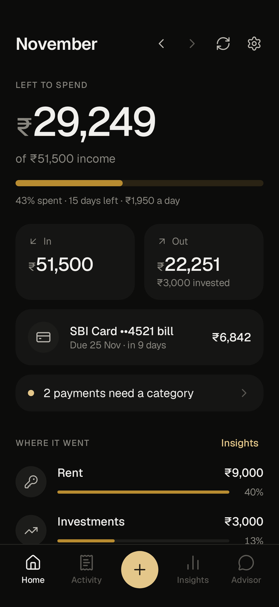
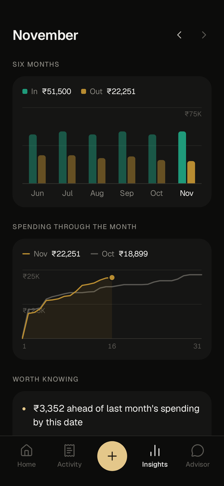
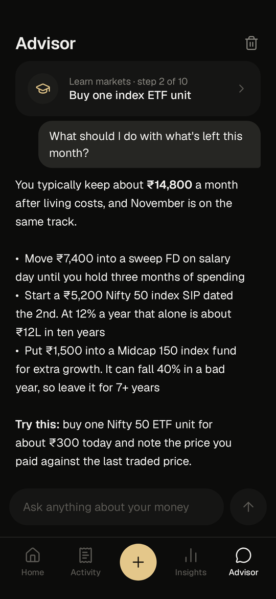
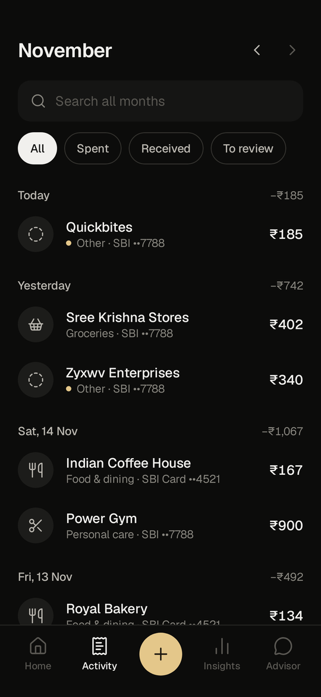
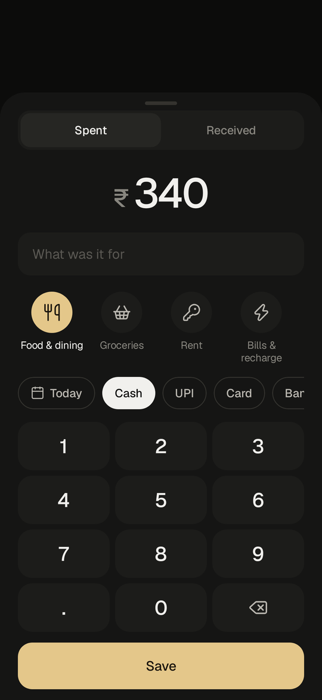
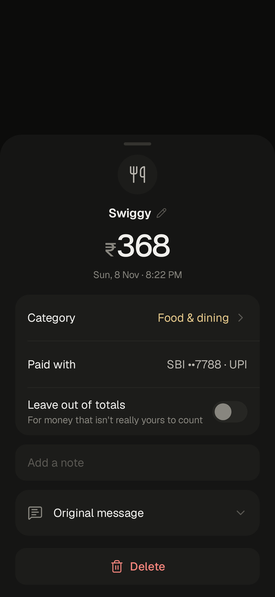

# Kanakku

A private monthly budget for Android that keeps itself. Kanakku (കണക്ക്, "accounts") reads the bank,
card and UPI alerts already on your phone and works out what came in, what went out and what is
left. Nothing leaves the device unless you add your own Gemini key for advice.

<p>
  
  
  
</p>
<p>
  
  
  
</p>

## What it does

- **Reads alerts automatically.** Indian bank, credit-card and wallet SMS (SBI, SBI Card, HDFC, ICICI,
  Axis, Kotak, Federal Bank, South Indian Bank, Canara and others, including unknown co-operative
  banks) are parsed into transactions. A receiver wakes the app for a moment when an alert arrives;
  a twice-daily job and a manual **Sync** cover anything missed. There is no background service.
- **Skips secrets.** OTPs, PINs, CVVs and passwords are rejected before parsing and never stored.
  Promotions, payment requests, reminders and failed payments are ignored.
- **Understands the money.** Salary is recognised by a configurable amount range; month-end salary
  counts for the month it pays for; card bill payments are transfers, not spending; refunds reduce
  their category; duplicate alerts for one payment are counted once.
- **Categorises for Kerala.** A dictionary of national and Kerala brands (KSEB, KSRTC, Kochi Metro,
  Supplyco, Lulu, Milma, KSFE …) plus a lexicon of local shop names (Bakery, Medicals, Thattukada,
  Fuels, Textiles …). Correct a category once and it is remembered for that merchant.
- **Manual entry** with a purpose-built keypad, for cash and anything without an SMS.
- **Insights.** Six-month in/out columns, spending pace against last month, ranked categories, top
  merchants, recurring payments, card bill due dates.
- **Advisor (optional).** With your own Gemini API key, ask questions about your money. Answers are
  grounded in your ledger, an on-device allocation rule and a local knowledge base (retrieval-augmented).
  A ten-step "learn markets" track teaches investing and trading with small real stakes.

## Privacy

- All data is stored in the app's private storage. Cloud backup and device transfer are disabled.
- The only network calls are to the Gemini API, and only after you add a key in Settings.
  Sent: monthly totals, merchant names, amounts, dates and a rounded balance.
  Never sent: message text, account or card numbers.
- The key is encrypted with the Android Keystore.

## Install

Download the APK from Releases (or build it, below) and open it on the phone.

Because the app is installed from a file and reads SMS, Android adds a few steps:

1. **Samsung Auto Blocker** (One UI 6.1.1+): turn off under Settings → Security and privacy → Auto Blocker
   while installing.
2. **Play Protect** may refuse an unknown app that requests SMS access. Either install over USB with
   `adb install Kanakku.apk`, or pause scanning in Play Store → Play Protect → settings, install, and turn it back on.
3. **Restricted setting.** When the app asks for SMS access Android may say the setting is restricted.
   Open Settings → Apps → Kanakku → ⋮ → *Allow restricted settings*, then allow again. The app shows
   these steps when it happens.

## Build

Requirements: JDK 17+, Android SDK with platform 37 (the Gradle wrapper fetches everything else).

```bash
./gradlew assembleDebug          # app/build/outputs/apk/debug/app-debug.apk
./gradlew testDebugUnitTest      # 129 tests, runs on the JVM with Robolectric
./gradlew assembleRelease        # signed if keystore.properties exists, otherwise debug-signed
```

To sign releases, create `keystore.properties` in the project root (it is git-ignored):

```properties
storeFile=your-release-key.jks
storePassword=…
keyAlias=…
keyPassword=…
```

Screenshots of every screen are rendered by the tests:

```bash
./gradlew testDebugUnitTest --tests 'app.kanakku.ScreensTest' -Proborazzi.test.record=true
# images in app/build/shots
```

## How it is put together

```
app/src/main/kotlin/app/kanakku
├── core/          Pure Kotlin, no Android types
│   ├── sms/       SensitiveFilter, Senders, SmsParser, DueParser
│   ├── category/  Categories, MerchantBook, Merchants, Categorizer
│   └── insight/   Month summaries, recurring payments, observations
├── data/          Room database, encrypted settings, Repository, SMS receiver and sync workers
├── ai/            Gemini client, KnowledgeBase (BM25 retrieval), Planner, LearningTrack, Advisor
└── ui/            Compose theme, components, charts and screens
```

The inbox is the single source of truth: every path (receiver, periodic job, opening the app, Sync)
runs the same idempotent inbox scan, so nothing is counted twice and nothing is lost if Android
puts the app to sleep.

Adding a bank format usually means adding a line to `SmsParserTest` and, if it fails, a pattern in
`SmsParser`. Adding a merchant is one line in `MerchantBook`.

## Notes on the advisor

The advisor gives general information and education, not regulated investment advice. Return
figures are historical ranges or illustrations, never promises; rates and tax rules in the knowledge
base are "as of" values that change.

## Licence

MIT – see [LICENSE](LICENSE). Bundled assets: Geist typeface and the launcher glyph from Anek Malayalam
(SIL Open Font License), Lucide icons (ISC). Texts are in [`licenses/`](licenses).
